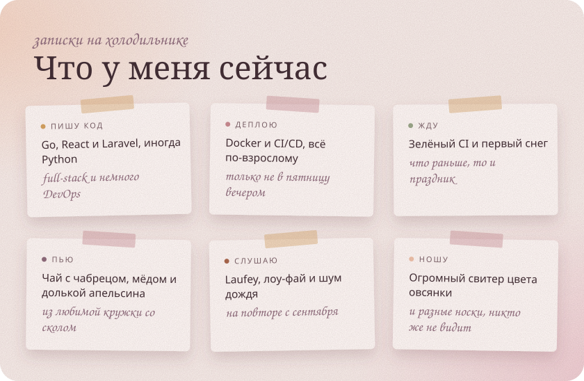
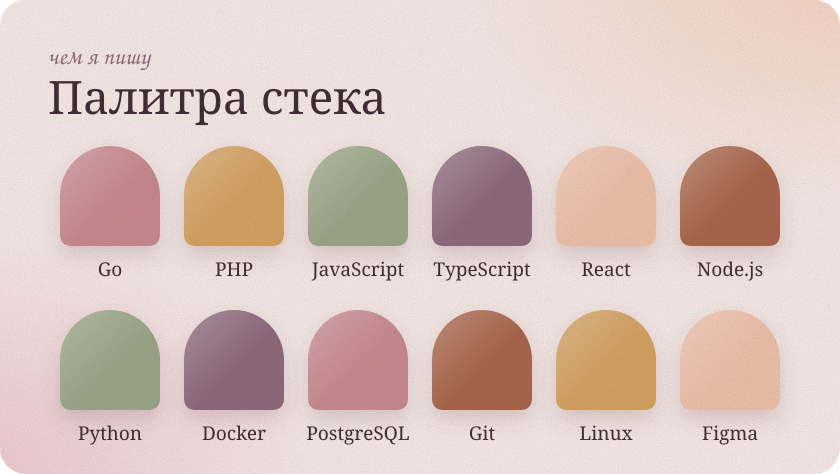

  <picture>
    <source media="(prefers-color-scheme: dark)" srcset="assets/header-dark.svg">
    
  </picture>

  <i>Привет! Я пишу бэкенд на Go и Laravel, собираю интерфейсы на React 
  и бережно упаковываю всё это в Docker. Здесь тихо, тепло и пахнет печёными яблоками.</i>

  <picture>
    <source media="(prefers-color-scheme: dark)" srcset="assets/now-dark.svg">
    
  </picture>

  <picture>
    <source media="(prefers-color-scheme: dark)" srcset="assets/quote-dark.svg">
    
  </picture>

  <picture>
    <source media="(prefers-color-scheme: dark)" srcset="assets/stack-dark.svg">
    
  </picture>

  <picture>
    <source media="(prefers-color-scheme: dark)" srcset="assets/note-dark.svg">
    
  </picture>

